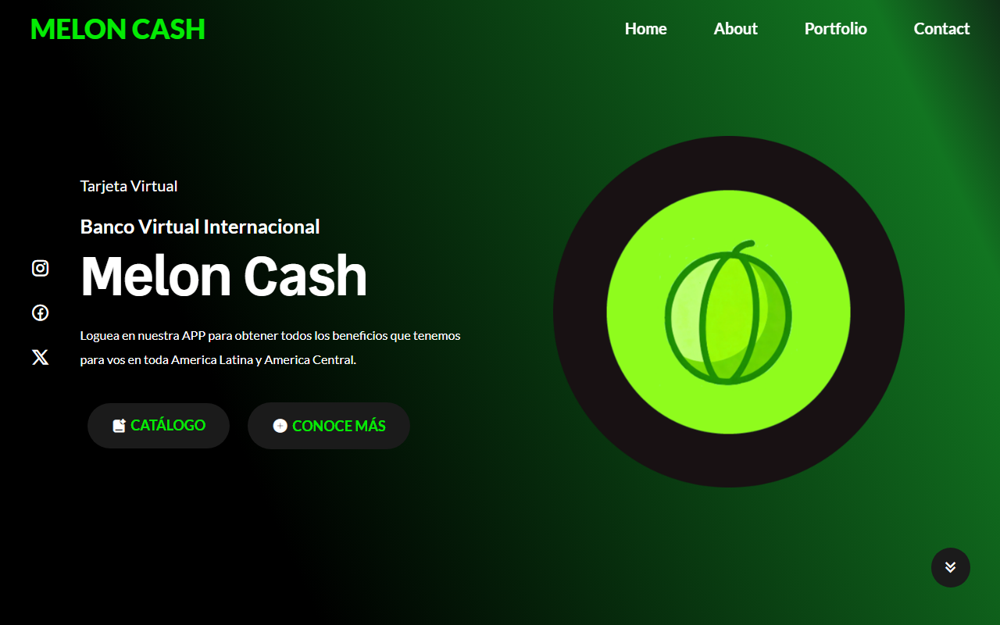
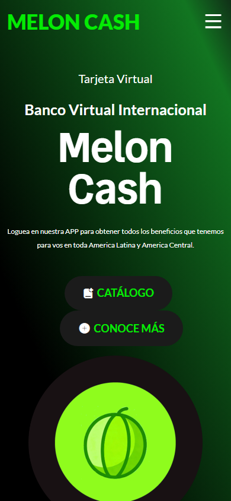

# Melon Cash · Landing page

Landing page de una tarjeta virtual presentada como proyecto final del curso de Maquetación Web. Incluye header con menú responsive, sección hero con llamados a la acción, iconos sociales y scroll indicator.

Hecha solo con **HTML5 y CSS3**, sin frameworks ni build.


## Contenido

- [Capturas](#capturas)
- [Características](#características)
- [Stack](#stack)
- [Estructura del repositorio](#estructura-del-repositorio)
- [Cómo verla](#cómo-verla)
- [Despliegue](#despliegue)

## Capturas

| Desktop | Mobile |
| :-----: | :----: |
|  |  |

## Características

- **Hero** con título, copy, botones **Catálogo** y **Conoce más**, e imagen principal.
- **Menú responsive** con checkbox toggler y lista de navegación (Home, About, Portfolio, Contact).
- **Iconos** de Boxicons y Remixicon, y tipografías Lato / Vend Sans desde Google Fonts.
- **Diseño adaptable** probado en escritorio y en celular.
- **Sin dependencias de instalación**: se abre directamente en el navegador.

## Stack

| Capa | Tecnologías |
| --- | --- |
| Estructura | HTML5 semántico |
| Estilos | CSS3 con hoja única `style.css` |
| Iconos | Boxicons · Remixicon |
| Tipografías | Google Fonts (Lato, Vend Sans) |

## Estructura del repositorio

```text
Proyecto-final-maquetacion-web/
├── assets/
│   └── imgs/          # imágenes del producto
├── index.html
└── style.css
```

## Cómo verla

Podés abrir `index.html` directamente en el navegador. Si preferís servirla por HTTP:

```bash
python -m http.server 8000
```

Y entrar a <http://localhost:8000>.

## Despliegue

No requiere build. Publicá la raíz del repositorio en GitHub Pages, Netlify, Vercel o cualquier hosting estático.
